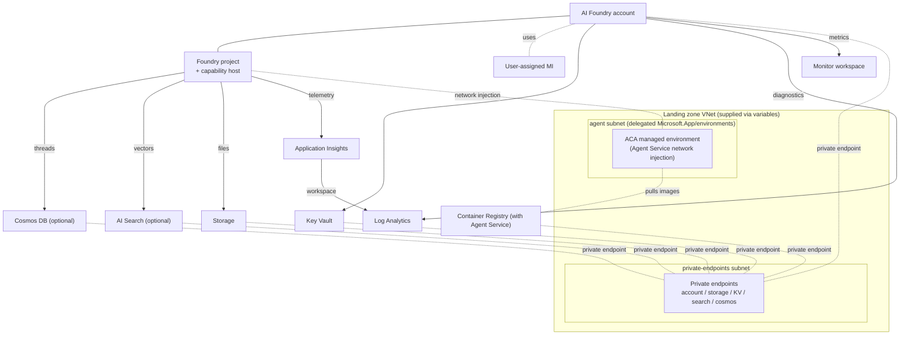

# AIFoundry — Enterprise Azure AI Foundry (Terraform)

Reusable, landing-zone-agnostic Terraform that provisions an **enterprise-ready,
private, Entra-only Azure AI Foundry** account (Cognitive Services
`kind = AIServices`) together with an AI Foundry **project**, **model deployments**,
and the adjacent services required to run the **Agent Service** securely inside a
private virtual network.

Everything is **private by default**: public network access is disabled, key-based
(local) auth is disabled, and every resource is reachable only through **private
endpoints**.

This module does **not** create any networking. It **consumes an existing landing
zone** — the virtual network, subnets, egress firewall and (optionally) private DNS
zones — entirely through **input variables**. Those variables are the module's
**stable public interface**, designed to plug into many different enterprise
environments. See [Section 4 — Landing zone expectations](#4-landing-zone-expectations).

---

## 1. Overview

| Aspect | Value |
|--------|-------|
| Account kind | `Microsoft.CognitiveServices/accounts` — `AIServices` (Foundry) |
| Auth | Entra ID only (`local_auth_enabled = false`) |
| Network | Private endpoints only (`public_network_access_enabled = false`) |
| Identity | User-assigned managed identity (Entra ID / RBAC to dependencies) |
| Always deployed | Foundry account + project + models, Key Vault, Storage, Log Analytics, Monitor workspace, **Application Insights** |
| Optional | AI Search, Cosmos DB, Agent Service (network-injected), **Container Registry** (auto-on with Agent Service) |
| Network ownership | **Not** created here — supplied by the landing zone via variables |

---

## 2. Architecture



The module creates the Foundry account, project, model deployments, managed
identity, Key Vault, Storage, Log Analytics, Monitor workspace, and the optional AI
Search / Cosmos DB — plus their private endpoints and role assignments. The VNet,
subnets, firewall and DNS zones are **inputs**, not outputs.

**Naming convention** (CAF): `<workload>-<env>-<abbr>[-<role>]-<seq>`, e.g. with
`workload = sko`, `env = dev`, `seq = 01`: `sko-dev-aif-01`, `sko-dev-kv-fdy-01`,
`sko-dev-log-foundry-01`, `skodevstfnd01` (storage, compact form).

---

## 3. Prerequisites

### 3.1 Register resource providers

```powershell
az provider register --namespace Microsoft.CognitiveServices --wait
az provider register --namespace Microsoft.Storage --wait
az provider register --namespace Microsoft.KeyVault --wait
az provider register --namespace Microsoft.Search --wait
az provider register --namespace Microsoft.Network --wait
az provider register --namespace Microsoft.Monitor --wait

# Agent Service capability host (serverless container infrastructure)
az provider register --namespace Microsoft.App --wait
az provider register --namespace Microsoft.ContainerService --wait
az provider register --namespace Microsoft.MachineLearningServices --wait
```

### 3.2 Identity and tooling

- **Terraform** >= 1.6 and **Azure CLI**.
- Run from a host with **network line-of-sight to the private endpoints** — e.g. a
  jump host, Azure Bastion VM, or a VPN/ExpressRoute path into the landing zone VNet.
  After public access is disabled, data-plane calls fail from a public workstation.
- An **`az login`** session whose identity is a member of the **`admin_group`**
  (owners/super-admins of the Foundry resources) and can create **role assignments**
  (Role Based Access Administrator or Owner) on the deployed resources.

---

## 4. Landing zone expectations

The module treats the landing zone as an external contract. Before applying, the
landing zone must provide the following and expose them to the module through input
variables.

| Requirement | Provided to module via | Notes |
|-------------|------------------------|-------|
| Virtual network in the target region | (implicit via subnet IDs) | Foundry account **must be in the same region** as the VNet. |
| Private-endpoints subnet | `private_endpoints_subnet_resource_id` | **Required.** Hosts all PEs (account, storage, KV, search, cosmos). |
| Agent subnet (only for Agent Service) | `agent_subnet_resource_id` | Delegated to `Microsoft.App/environments`. See Section 5.1. |
| Private DNS zones **or** policy-based DNS | `private_dns_zone_resource_ids` | Supply zone IDs, or omit to let a central DNS/Policy resolve records. See Section 5.2. |
| Egress firewall allowlist | (out of band, in the landing zone) | NTP + ACA control-plane + HTTPS FQDNs. See Section 5.3. |
| Management connectivity | (out of band) | Jump host / Bastion / VPN / ExpressRoute into the VNet. |
| Entra admin group | `admin_group_name`, `admin_group_id` | Owners of the account/project. |

The module does **not** assume any particular reference implementation of the landing
zone. Any environment that satisfies the contract above works.

---

## 5. Networking requirements

### 5.1 Subnets

| Subnet | Purpose | Sizing / delegation |
|--------|---------|---------------------|
| **Private endpoints** | PEs for account, storage, KV, search, cosmos | No delegation. Size for the number of endpoints (~5–15). A `/27` is a comfortable minimum; grow it if you scale out. **Required.** |
| **Agent** | Agent Service network injection (ACA managed environment) | **Delegated to `Microsoft.App/environments`.** Supplying it **enables** the Agent Service; omit to disable. See sizing below. |

#### Agent subnet — officially supported range

The agent subnet is consumed by the Azure Container Apps managed environment that
backs Agent Service network injection. Its constraints come from that platform:

- **Minimum size: `/27`** — this is the smallest range the network injection accepts.
- **Recommended size: `/24` (256 addresses)** — recommended by the platform because
  the subnet is delegated to `Microsoft.App/environments`; a `/24` leaves headroom for
  the environment to scale and for rolling revisions. Use `/24` for production.
- **Dedicated per Foundry account** — the agent subnet **cannot be shared** by
  multiple Foundry accounts. Each account needs its own delegated subnet (the VNet may
  be shared).
- **RFC1918 address space only** — must fall in `10.0.0.0/8`, `172.16.0.0/12`
  (`172.16–31.x.x`) or `192.168.0.0/16`.
  - **Class B (`172.16–31.x.x`) and Class C (`192.168.x.x`) work in all regions.**
  - **Class A (`10.0.0.0/8`) is supported only in specific regions.** In other regions
    use a Class B or Class C range.
  - Public ranges (e.g. `44.x.x.x`), CGNAT (`100.64.0.0/10`), and reserved ranges
    (`169.254.0.0/16`, `168.63.129.16`, `172.30/31.0.0/16`, `192.0.2.0/24`,
    `0.0.0.0/8`, `127.0.0.0/8`, etc.) are **not** supported and must not overlap any
    peered network.
- **Same region as the Foundry account** — the account and the VNet/agent subnet must
  be co-located; the adjacent Storage / Cosmos / Search may be in other regions.

> Reference sizing from an auto-provisioned setup: VNet `192.168.0.0/16`, agent subnet
> `192.168.0.0/24`, private-endpoints subnet `192.168.1.0/24`.

### 5.2 Private DNS zones

The Foundry account always needs:

```raw
privatelink.cognitiveservices.azure.com
privatelink.openai.azure.com
privatelink.services.ai.azure.com
privatelink.blob.core.windows.net
privatelink.vaultcore.azure.net
privatelink.file.core.windows.net
```

Optional (only when the matching service is enabled):

```raw
privatelink.search.windows.net        # AI Search
privatelink.documents.azure.com       # Cosmos DB (NoSQL)
privatelink.dfs.core.windows.net      # Storage Data Lake (if used)
privatelink.azurecr.io                # Container Registry (with Agent Service)
```

DNS integration is controlled by `private_dns_zone_resource_ids`:

- **Supply** a zone ID -> Terraform creates the private DNS zone group (A-records) for
  that private endpoint.
- **Omit / null** -> the private endpoint is still created, but DNS records are managed
  **out-of-band** by the landing zone (e.g. an Azure Policy `deployIfNotExists` in a
  central connectivity subscription, or a conditional forwarder to `168.63.129.16`).

### 5.3 Egress firewall requirements

If the agent subnet is force-tunneled to a firewall, the Agent Service network
injection provisions an **Azure Container Apps managed environment** that needs NTP
time sync and several control-plane flows in addition to the HTTPS allowlist.
**Without them the managed environment (and therefore the Foundry account) hangs in
"Creating".** These rules live in the **landing zone firewall**, not in this module.

```hcl
# NTP time sync (UDP 123)
rule {
  name                  = "ntp"
  source_addresses      = [<agent-subnet-address-space>]
  destination_addresses = ["*"]
  destination_ports     = ["123"]
  protocols             = ["UDP"]
}

# ACA control-plane service tags (TCP 443)
rule {
  name             = "aca-control-plane"
  source_addresses = [<agent-subnet-address-space>]
  destination_addresses = [
    "MicrosoftContainerRegistry",
    "AzureFrontDoor.FirstParty",
    "AzureActiveDirectory",
    "AzureMonitor",
    "AzureContainerRegistry",
  ]
  destination_ports = ["443"]
  protocols         = ["TCP"]
}
```

Baseline HTTPS (443) FQDN allowlist:

```raw
*.cognitiveservices.azure.com
*.openai.azure.com
*.services.ai.azure.com
ai.azure.com
*.ai.azure.com
*.search.windows.net
*.blob.core.windows.net
*.file.core.windows.net
*.vaultcore.azure.net
*.documents.azure.com
*.monitor.azure.com
*.ods.opinsights.azure.com
*.oms.opinsights.azure.com
*.applicationinsights.azure.com
*.in.applicationinsights.azure.com
login.microsoftonline.com
*.login.microsoftonline.com
login.microsoft.com
*.login.microsoft.com
*.identity.azure.net
management.azure.com
mcr.microsoft.com
*.data.mcr.microsoft.com
*.azurecr.io
packages.microsoft.com
# --- Agent Service (ACA managed environment is AKS-backed) ---
# No service-tag equivalent; must be application rules.
packages.aks.azure.com
acs-mirror.azureedge.net
```

> Do **not** enable TLS inspection for this traffic — a self-signed intercept
> certificate breaks the managed environment. If provisioning fails, check what the
> firewall is blocking, and confirm the `AzureActiveDirectory` service tag is allowed.

---

## 6. Deployment topologies

The optional services combine into supported permutations. The Agent Service is
enabled **implicitly** when an agent subnet is supplied
(`enable_agent_service = agent_subnet_resource_id != null`).

| Topology | `agent_subnet_resource_id` | `enable_ai_search` | `enable_cosmosdb` | Result |
|----------|:--:|:--:|:--:|--------|
| **Minimal** | null | false | false | Foundry + models, KV, Storage, LAW, Monitor. No Agent Service. |
| Minimal + Search | null | true | false | Adds AI Search (vector store) — usable for retrieval, no agents. |
| Minimal + Cosmos | null | false | true | Adds Cosmos DB — no agents. |
| **Agent (basic)** | set | false | false | Agent Service capability host in **basic** mode (platform-managed thread/vector store). |
| **Agent (BYO / standard)** | set | true | true | `create_agent_byo = true`. Capability host wired to your Storage (files), Cosmos DB (threads) and AI Search (vectors). |

> The **bring-your-own (standard)** Agent Service requires **all three**: agent subnet
> **and** Cosmos DB **and** AI Search. Supplying only one of the two adjacent stores
> yields a **basic** capability host.

> Whenever `agent_subnet_resource_id` is supplied, a **Premium, zone-redundant Azure
> Container Registry** is provisioned automatically with a private endpoint. It hosts
> the images the ACA managed environment pulls; if you omit the agent subnet, no ACR
> is created.

---

## 7. Configuration reference (the module interface)

These variables are the entire contract between your landing zone and the module.

### Core

| Variable | Type | Default | Description |
|----------|------|---------|-------------|
| `location` | string | `uksouth` | Region (short form). Must equal the VNet region. |
| `resource_name_workload` | string | `sko` | Workload segment (<= 4 chars). |
| `resource_name_environment` | string | `dev` | Environment segment (<= 4 chars). |
| `resource_name_sequence_start` | number | `1` | Sequence number (1–99). |
| `tags` | map(string) | — | Tags applied to all resources. |
| `admin_group_name` | string | — | Display name of the Entra admin group (owners). |
| `admin_group_id` | string (GUID) | — | Object ID of the Entra admin group. |
| `log_analytics_workspace_retention_in_days` | number | `90` | LAW retention (30–730). |

### Account posture

| Variable | Type | Default | Description |
|----------|------|---------|-------------|
| `ai_foundry_sku` | string | `S0` | Cognitive Services SKU. |
| `ai_foundry_public_network_access_enabled` | bool | `false` | Public access (break-glass only). |
| `ai_foundry_local_auth_enabled` | bool | `false` | Key-based auth (keep false for Entra-only). |

### Networking (landing-zone inputs)

| Variable | Type | Default | Description |
|----------|------|---------|-------------|
| `private_endpoints_subnet_resource_id` | string | — | **Required.** Full subnet ID for private endpoints. |
| `agent_subnet_resource_id` | string | `null` | Delegated agent subnet ID. Set -> enables Agent Service. `/27` min, `/24` recommended. |
| `private_dns_zone_resource_ids` | object | `{}` | Per-zone DNS zone IDs (`cognitiveservices`, `openai`, `ai`, `blob`, `file`, `vault`, `search`, `cosmos_sql`, `container_registry`). Omit a key to manage DNS out-of-band. |

### Project and models

| Variable | Type | Default | Description |
|----------|------|---------|-------------|
| `ai_foundry_project_name` | string | `proj-default` | Project resource name (2–32, alnum + hyphen). |
| `ai_foundry_project_display_name` | string | `Default Project` | Human-friendly name. |
| `ai_foundry_project_description` | string | … | Project description. |
| `ai_foundry_model_deployments` | map(object) | `{}` | Model deployments. Key = deployment name; fields: `model_name`, `model_version`, `model_format` (`OpenAI`), `sku_name` (`GlobalStandard`), `sku_capacity`, `rai_policy_name`. |

### Optional adjacent resources

| Variable | Type | Default | Description |
|----------|------|---------|-------------|
| `enable_ai_search` | bool | `false` | Provision AI Search (private, Entra-only). |
| `ai_search_sku` | string | `standard` | AI Search SKU when enabled. |
| `enable_cosmosdb` | bool | `false` | Provision Cosmos DB NoSQL (private, Entra-only). |

---

## 8. Example configurations

### 8.1 Minimal (no Agent Service, out-of-band DNS)

```hcl
resource_name_workload    = "sko"
resource_name_environment = "dev"
location                  = "swedencentral"

private_endpoints_subnet_resource_id = "/subscriptions/<sub>/resourceGroups/<rg>/providers/Microsoft.Network/virtualNetworks/<vnet>/subnets/<pe-subnet>"
# agent_subnet_resource_id omitted -> Agent Service disabled

admin_group_name = "mhub-dev-super-admins"
admin_group_id   = "00000000-0000-0000-0000-000000000000"

ai_foundry_model_deployments = {
  "gpt-5" = { model_name = "gpt-5", model_version = "2025-08-07", sku_name = "GlobalStandard", sku_capacity = 20 }
}

enable_ai_search = false
enable_cosmosdb  = false

tags = { SecurityControl = "Ignore" }
```

### 8.2 Full — Agent Service (BYO / standard) with Terraform-managed DNS

```hcl
resource_name_workload    = "sko"
resource_name_environment = "dev"
location                  = "swedencentral"

# PE subnet (any size that fits the endpoints); agent subnet /24 recommended,
# delegated to Microsoft.App/environments, RFC1918 (172.16-31.x.x or 192.168.x.x).
private_endpoints_subnet_resource_id = "/subscriptions/<sub>/.../subnets/<pe-subnet>"
agent_subnet_resource_id             = "/subscriptions/<sub>/.../subnets/<agent-subnet>"

admin_group_name = "mhub-dev-super-admins"
admin_group_id   = "00000000-0000-0000-0000-000000000000"

private_dns_zone_resource_ids = {
  cognitiveservices = "/subscriptions/<sub>/.../privateDnsZones/privatelink.cognitiveservices.azure.com"
  openai            = "/subscriptions/<sub>/.../privateDnsZones/privatelink.openai.azure.com"
  ai                = "/subscriptions/<sub>/.../privateDnsZones/privatelink.services.ai.azure.com"
  blob              = "/subscriptions/<sub>/.../privateDnsZones/privatelink.blob.core.windows.net"
  file              = "/subscriptions/<sub>/.../privateDnsZones/privatelink.file.core.windows.net"
  vault             = "/subscriptions/<sub>/.../privateDnsZones/privatelink.vaultcore.azure.net"
  search            = "/subscriptions/<sub>/.../privateDnsZones/privatelink.search.windows.net"
  cosmos_sql        = "/subscriptions/<sub>/.../privateDnsZones/privatelink.documents.azure.com"
}

ai_foundry_project_name         = "proj-sko-dev"
ai_foundry_project_display_name = "SKO Dev AI Foundry"

ai_foundry_model_deployments = {
  "gpt-5"                  = { model_name = "gpt-5",                  model_version = "2025-08-07", sku_name = "GlobalStandard", sku_capacity = 20 }
  "text-embedding-3-large" = { model_name = "text-embedding-3-large", model_version = "1",          sku_name = "Standard",       sku_capacity = 10 }
}

# BYO Agent Service needs BOTH of these + the agent subnet above.
enable_ai_search = true
enable_cosmosdb  = true

tags = { SecurityControl = "Ignore" }
```

---

## 9. Deploy

```powershell
terraform init
terraform plan -out tfplan
terraform apply tfplan
```

> A steady-state re-plan may show ~14 **in-place** updates (diagnostic-setting metric
> deprecation, azapi body re-normalization, telemetry). These are **no-op re-sends** —
> not real drift. See Section 11.4.

---

## 10. Outputs

| Output | Description |
|--------|-------------|
| `resource_group_name` | Foundry-phase resource group. |
| `ai_foundry_account_id` / `ai_foundry_account_name` | Foundry account ID / name. |
| `ai_foundry_endpoint` | Account endpoint. |
| `ai_foundry_project_id` / `ai_foundry_project_name` | Project ID / name. |
| `foundry_managed_identity_id` / `foundry_managed_identity_principal_id` | User-assigned MI IDs. |
| `key_vault_id` | Adjacent Key Vault ID. |
| `storage_account_id` | Adjacent Storage account ID. |
| `log_analytics_workspace_id` | Log Analytics workspace ID. |
| `monitor_workspace_id` | Azure Monitor workspace ID. |
| `application_insights_id` | Application Insights resource ID. |
| `application_insights_connection_string` | App Insights connection string (**sensitive**). |
| `ai_search_id` | AI Search ID (null when disabled). |
| `cosmosdb_id` | Cosmos DB ID (null when disabled). |
| `container_registry_id` | Container Registry ID (null when Agent Service disabled). |
| `container_registry_login_server` | ACR login server FQDN (null when Agent Service disabled). |

---

## 11. Troubleshooting

### 11.1 Soft-delete collision on redeploy

Cognitive Services / AIServices soft-delete is platform-enforced and cannot be
disabled. `terraform destroy` leaves a soft-deleted shadow holding the account name
and custom subdomain. Redeploying the same name stalls with `context deadline
exceeded`.

```powershell
# List active + soft-deleted accounts
az cognitiveservices account list -g <rg-foundry> -o table
az cognitiveservices account list-deleted -o table

# Delete then PURGE the shadow (location = the deleted account's region)
az cognitiveservices account delete -g <rg-foundry> -n <account-name>
az cognitiveservices account purge --location <region> --resource-group <rg-foundry> --name <account-name>

# Drop the stale state entry, then re-apply
terraform state rm 'module.ai_foundry.azapi_resource.ai_service[0]'
terraform apply
```

> **Teardown routine:** always `destroy` **then** `purge`. If the account is only
> *slow* (network-injected caphost can take > 30 min), it is a **timeout**, not a
> collision — increase the module `timeouts` (create/update/delete) instead of purging.
> When tearing down network injection, delete + purge the Foundry account **before**
> the VNet, otherwise a leftover service-association link blocks the subnet delete.

### 11.2 "User Assigned Identity not found" on account create

Cross-RP replication lag right after the identity is created. Handled by a 60-second
identity propagation delay before the account is created. If an account already
landed in `Failed`, purge it (Section 11.1), remove the `ai_service` from state, then
re-apply.

### 11.3 Agent Service / capability host stuck in "Creating"

- **#1 cause when the agent subnet is force-tunneled: missing AKS/CNI FQDNs on the
  firewall.** The ACA managed environment is AKS-backed and pulls Kubernetes/CNI
  binaries from `packages.aks.azure.com` and `acs-mirror.azureedge.net`. There is no
  service-tag equivalent — they must be application rules. Without them the nodes
  never bootstrap and the account hangs the full timeout.
- Confirm the agent subnet is **delegated to `Microsoft.App/environments`** and is at
  least a `/27` (`/24` recommended) in an **RFC1918** range valid for the region
  (Class A `10.x` only in supported regions; otherwise use `172.16–31.x` / `192.168.x`).
- Confirm the firewall **NTP (UDP 123)** and **ACA control-plane service-tag** rules
  are in place (Section 5.3) with **no TLS inspection** — without them the ACA managed
  environment never finishes.
- The **BYO (standard)** capability host requires **all three** connections (Storage,
  Cosmos DB, AI Search). Missing one yields
  `CapabilityHost supports a single, non empty value for ...Connections`.
- Verify private-endpoint DNS resolves to private IPs from inside the VNet
  (`nslookup <endpoint>`); a Cosmos DB timeout usually means broken PE/DNS.

### 11.4 Benign perpetual plan diff

A steady-state plan of `0 add / 0 destroy` with ~14 in-place updates (diagnostic
settings `metric` -> `enabled_metric`, azapi connection/account/deployment body
re-normalization, `modtm_telemetry`) are no-op re-sends. Do not chase them.
